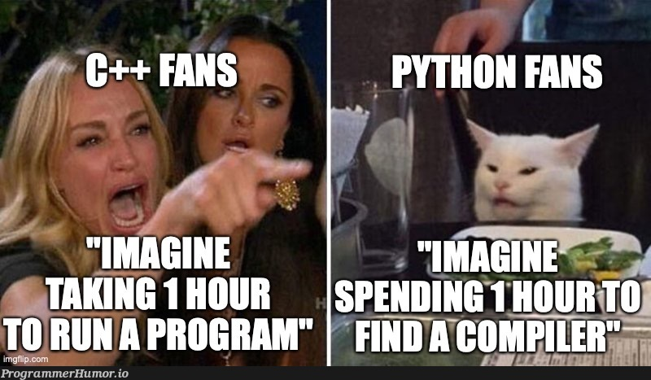

I’m really happy to say that I’ve finally finished the core documentation for GradientCore — my machine learning library built from scratch in C++. As a student, this project has been a massive learning journey.

<!--truncate-->

Writing all the documentation at the very end turned out to be quite frustrating. I should have been updating the docs along the way instead of trying to do everything in one big push. That was a hard lesson learned.

## How This Project Started

This project was born out of my strong dislike for coding in Python. I know Python is supposed to be easy, but for some reason the logic never flows naturally for me when I use it. I’ve always felt that C++ is the stronger language for this kind of work (though I’m sure life will humble me on this opinion one day).

That combination — frustration with Python and a real interest in machine learning — is what got this project going.

## The Early Days

I had no clear idea how to begin. So, like many others, I first asked ChatGPT for help. That didn’t work out very well.

After that, I found a great YouTube video by [Magicalbat](https://github.com/Magicalbat) called "[Coding a Machine Learning Library in C from Scratch](https://youtu.be/hL_n_GljC0I?si=d8fTJE5A83PzAIPJ)". That two-hour video was incredibly helpful. I watched it while building the first version of the library at the same time. You can still see those early matrix-based experiments in the original repository: GradientCore.

The arena memory allocator from his project is still a core part of GradientCore today. A big thank you to him for that foundation.

## The Great Tensor Pivot

There was one major issue with the first version: it was built entirely around matrices. To make the library actually useful and expandable, I needed to switch to a proper tensor system.

I tried doing this in a separate branch using AI assistance. Let’s just say it went badly. The code ended up as a complete mess — so tangled that I couldn’t understand it anymore. That failed branch is still there as a reminder.

## Starting Over

So I created a new repository and rebuilt everything from the beginning. I still used AI during this process, but I changed my approach. This time I did my own research first, made sure I understood the concepts, and only used AI for corrections and improvements.

We built it step by step:
- Tensor definitions and memory management
- Autograd system
- Optimizers
- Neural network module

The library broke down many times along the way — bugs from me, from the AI, and from everything in between. But we kept going and eventually got somewhere.

## Where Things Stand Now

GradientCore is now somewhat usable. I know it’s nowhere near the level of PyTorch, but every project has to start somewhere. So far, all testing has been done only on my local machine, so there are probably still bugs lurking around. That’s completely normal — and exactly why contributors would be very welcome.

There are already several more mature C++ machine learning libraries out there, such as:
- **libtorch** (PyTorch’s C++ API)
- **mlpack**
- **Flashlight**
- **dlib**

But here we are, building our own version.

## Thank You

- [**Magicalbat**](https://github.com/Magicalbat) – for providing such a strong starting point
- **PyTorch documentation** – for being incredibly helpful
- **Claude & Grok** – without your help, writing all this documentation would have been much more difficult. A lot of the documentation was AI-assisted, so if you find any gaps or awkward parts, that’s probably why — feel free to contribute and fix them!

***

**P.S.** — I plan to release a stable version soon. I’m also excited about eventually releasing this as a proper package so others can use it more easily.
